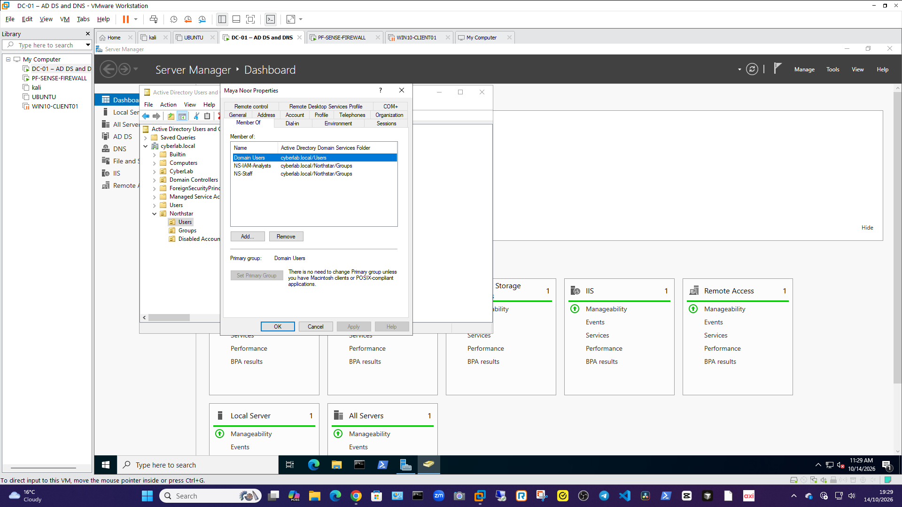

# Lab 1 — Identity Lifecycle

**Status:** In progress
**Company:** Northstar Community Services Ltd. *(fictional)*  
**Ticket:** IAM-LAB-001

## Objective

Practise an approved joiner, mover and leaver process in the isolated Active Directory lab. Apply least privilege, verify each access change, and keep an audit trail.

## Scenario

HR requests access for **Maya Noor**, a fictional employee joining as a Service Desk Analyst. Later, Maya moves into an IAM Analyst role and eventually leaves the company.

## Planned workflow

- **Joiner:** Record HR and manager approval, create the account, and grant the approved `NS-Staff` and `NS-ServiceDesk` group access.
- **Mover:** Record approval for the new role, remove `NS-ServiceDesk` access, and add approved `NS-IAM-Analysts` access.
-  **Leaver:** Record the effective leaving time, disable the account promptly, remove access, and retain the account record for audit according to the scenario.
  ## Mover completion

- **Completed:** 15 October 2026 (lab simulation).
- **Change:** Removed `NS-ServiceDesk`; added `NS-IAM-Analysts`; retained `NS-Staff` and `Domain Users`.
- **Verification:** Member Of tab showed the expected groups and no `NS-ServiceDesk` membership.

## Simulated leaver approval

- **Request:** Maya Noor’s fictional employment ends 14 October 2026.
- **Approver:** Nadia Ali, fictional HR Officer.
- **Approval:** Simulated for this lab.
- **Approved actions:** Disable the account, remove `NS-Staff` and `NS-IAM-Analysts`, move the disabled account to `Northstar/Disabled Accounts`, and retain the account object for audit.
- **Default group:** Retain `Domain Users` while the account is disabled.

## Simulated mover approval

- **Request:** Maya Noor moves from Service Desk Analyst to IAM Analyst.
- **Approver:** Jordan Patel, fictional Service Desk Manager.
- **Approval:** Simulated for this lab.
- **Approved access change:** Remove `NS-ServiceDesk`; add `NS-IAM-Analysts`; keep `NS-Staff`.

## Evidence to add after performing the lab

- Approval and request record using fictional details.
- Screenshots showing account status and group membership at each stage.
- A short action log with timestamps and verification results.
- A closure summary explaining how access was removed.

## Safety and scope

## Evidence

### Joiner — group membership

Shows Maya’s `Domain Users`, `NS-ServiceDesk` and `NS-Staff` memberships.

### Mover — group membership

Shows `NS-ServiceDesk` removed and `NS-IAM-Analysts` added.

## Results

- **Joiner:** Completed — account and approved group memberships verified.
- **Mover:** Completed — Service Desk access removed and IAM Analyst access added; verified.
- **Leaver:** Pending — approval recorded; account disablement and access removal still to be performed.
