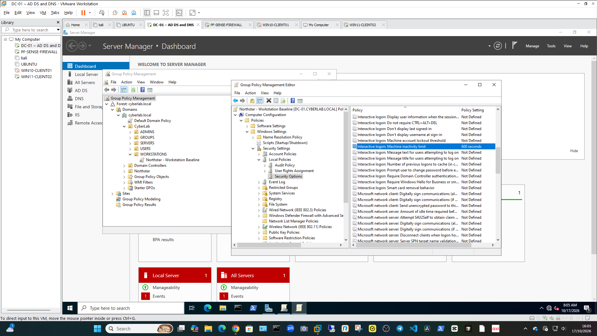
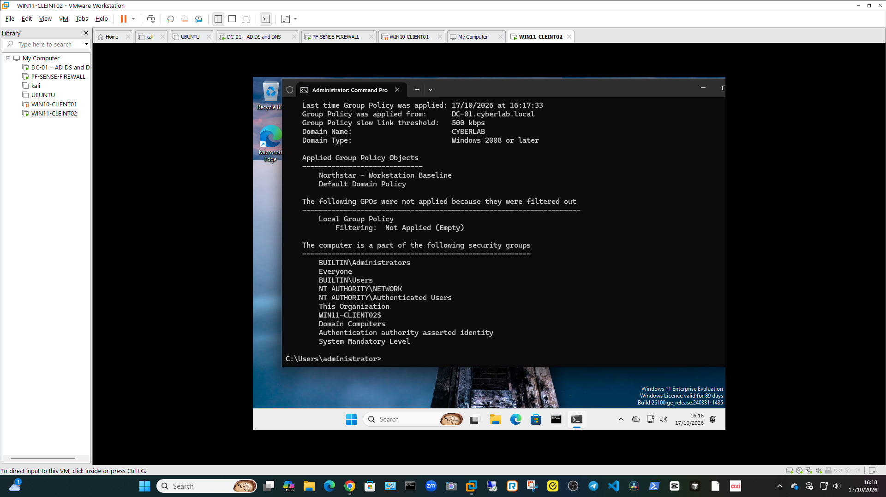
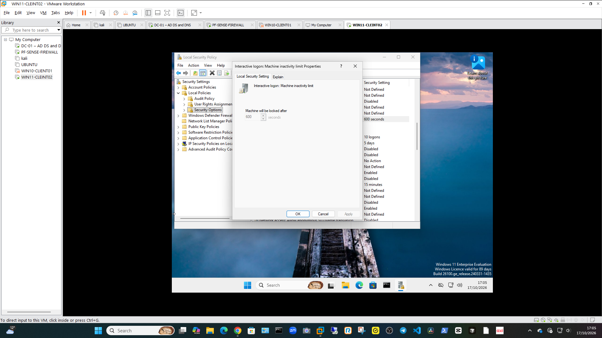

# IAM-LAB-004 — Active Directory and Group Policy

**Status:** Completed  
**Environment:** Isolated VMware lab  
**Domain:** `cyberlab.local`  
**Organisation:** Northstar (fictional)

## Objective

Create and apply a computer security policy using Active Directory Group Policy, then verify that the target Windows 11 computer receives the setting.

## Scenario

Northstar wants its workstations to lock after 10 minutes of inactivity. I configured a Group Policy Object (GPO) and applied it to a test workstation in the lab domain.

This is a fictional, isolated lab. No Union or production tenant was used.

## Planned workflow

1. Create the **Northstar - Workstation Baseline** GPO.
2. Configure the machine inactivity limit to 600 seconds.
3. Link the GPO to the `CyberLab\WORKSTATIONS` OU.
4. Confirm `WIN11-CLIENT02` is in that OU.
5. Refresh computer policy and verify the applied GPO.
6. Check the setting on the Windows 11 client.

## Steps performed

1. Created **Northstar - Workstation Baseline** in Group Policy Management.
2. Configured **Interactive logon: Machine inactivity limit** to **600 seconds** under Computer Configuration > Policies > Windows Settings > Security Settings > Local Policies > Security Options.
3. Linked the GPO to `CyberLab\WORKSTATIONS`.
4. Placed `WIN11-CLIENT02` in the target OU.
5. Refreshed policy with `gpupdate /force`.
6. Checked computer policy results with `gpresult /r /scope computer`.
7. Opened Local Security Policy on `WIN11-CLIENT02` and confirmed the setting showed **600 seconds**.

## Results

- **GPO:** Northstar - Workstation Baseline
- **Target:** `WIN11-CLIENT02`
- **Policy result:** The GPO appeared in the applied computer Group Policy Objects.
- **Setting verified on client:** 600 seconds (10 minutes).
- No production or Union tenant settings were changed.

An idle-lock test was not used as proof because the virtual machine may already have its own lock behaviour. The applied GPO result and the client-side setting were used for verification.

## Evidence

### 1. GPO setting

### 2. Applied Group Policy result

### 3. Client-side setting

## Key learning

Computer GPOs apply according to their link and the location of the computer account in Active Directory. Verifying both the applied GPO and the resulting client setting helps confirm that the policy reached the intended workstation.
