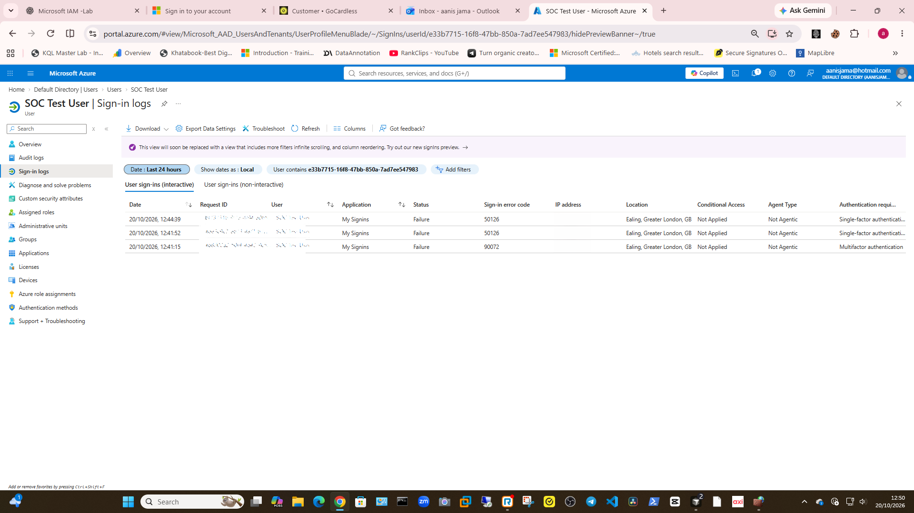
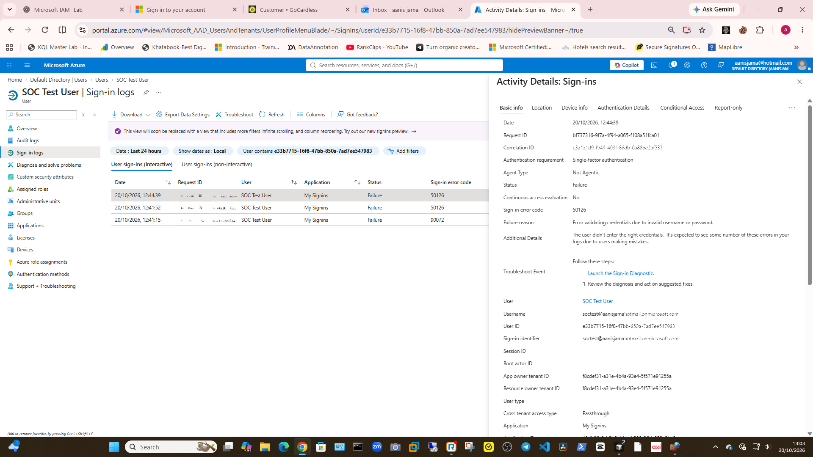
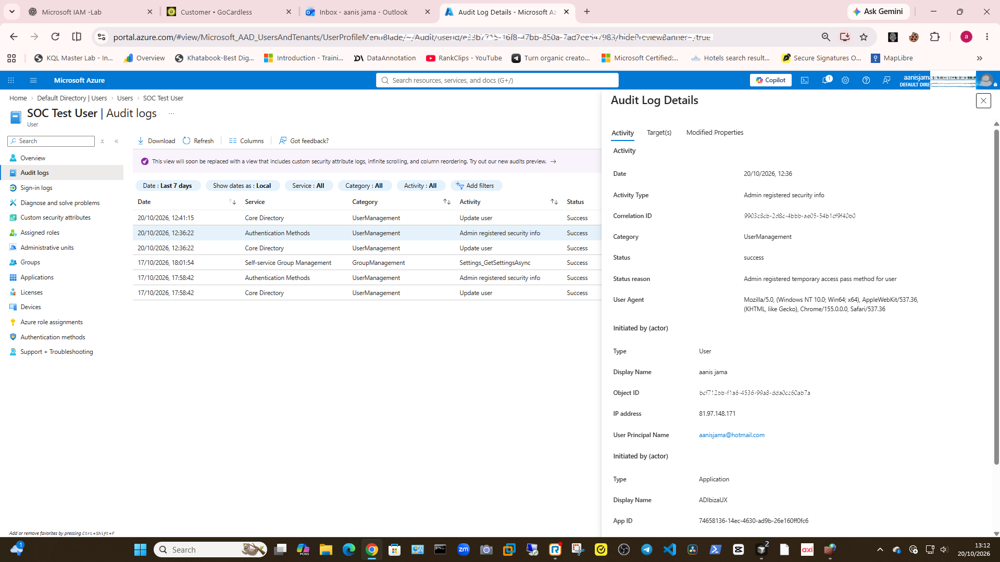

# Lab 5 — Microsoft Entra Sign-in and Audit Log Review

## Objective
Review sign-in and audit logs for a fictional test user in my personal Azure trial tenant.

## Activities
- Reviewed interactive sign-in events for the last 24 hours.
- Inspected the AADSTS50126 failure details.
- Checked the audit log for the Temporary Access Pass (TAP) creation event.

## Findings
- Three sign-in failures appeared in the selected time window; no successful sign-in was visible in the filtered list.
- AADSTS50126 reported a credential validation failure.
- The audit log confirmed that an administrator successfully created a TAP for the test user.
- TAP sign-in did not complete, and Microsoft Authenticator was not registered.

## Evidence
- 
- 
- 

## Security
This lab used fictional accounts in my personal trial tenant. No TAP secret is included in this portfolio.
