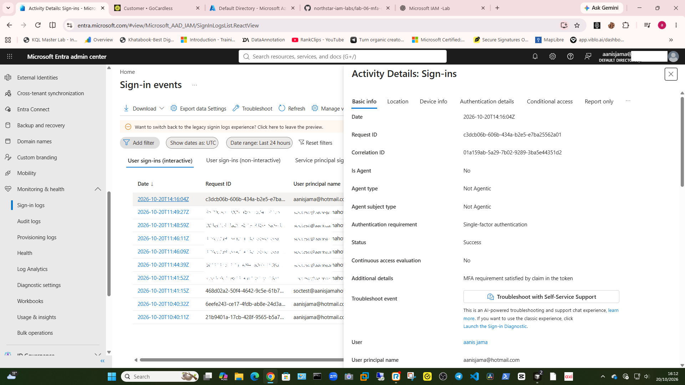
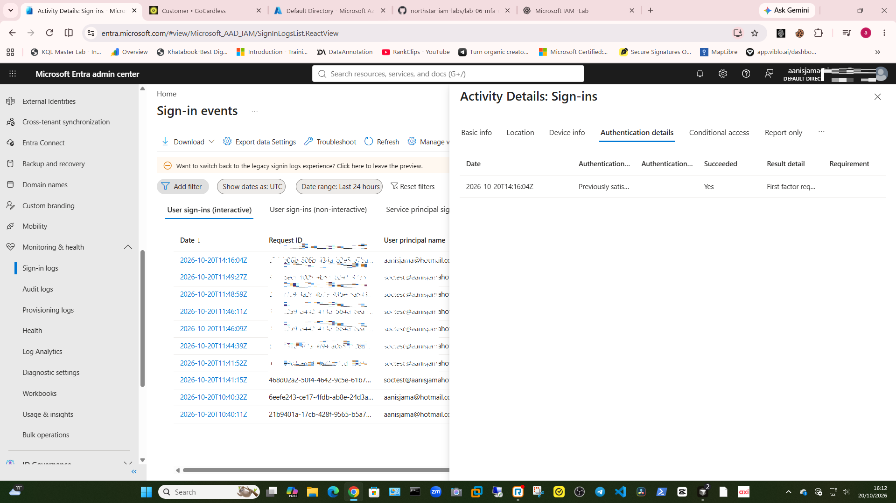
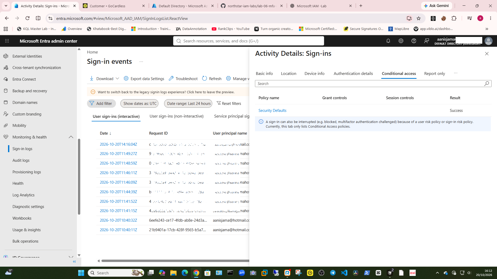

# Lab 6 — Microsoft Entra MFA and Conditional Access
Status: Completed — Entra ID Free tenant checks documented; MFA was satisfied by an existing token claim, and premium-only reporting was unavailable.

## Objective
Practise checking MFA and Conditional Access settings, testing access with a dedicated account, and reviewing the resulting sign-in logs.

## Scenario
A test user needs stronger sign-in protection. The administrator checks the tenant’s available features, applies an appropriate test configuration, verifies the user’s sign-in, and records the outcome.

## Planned workflow
1. Check the tenant, available licences, and administrator role.
2. Confirm the test account and keep the administrator account separate.
3. Review the tenant’s MFA and authentication-method settings.
4. Configure a test policy only if the tenant supports it.
5. Test sign-in with the fictional test account.
6. Review the Entra sign-in logs and document the result.
7. Remove or disable the test configuration if it is no longer needed.

## Safety
- Use the personal trial tenant and fictional accounts only.
- Do not apply a policy to all users.
- Keep the administrator account excluded from test policies.
- Do not record passwords, TAP codes, or other secrets.

## Evidence
Add redacted screenshots after completing the lab. Record any feature or licence limitation encountered.

