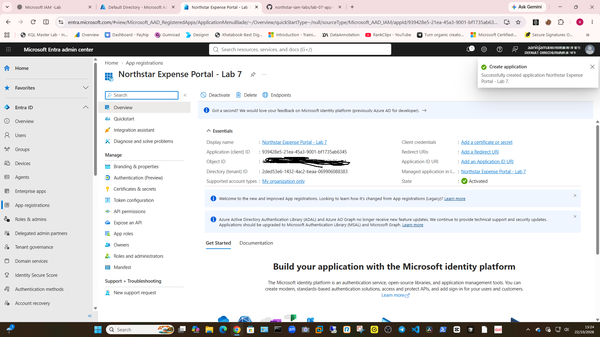
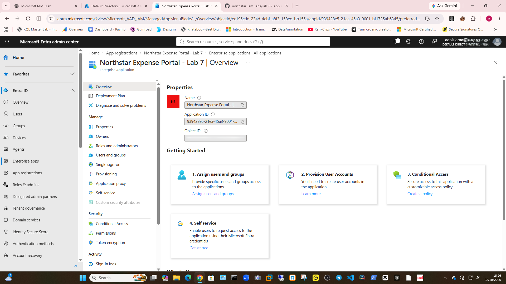
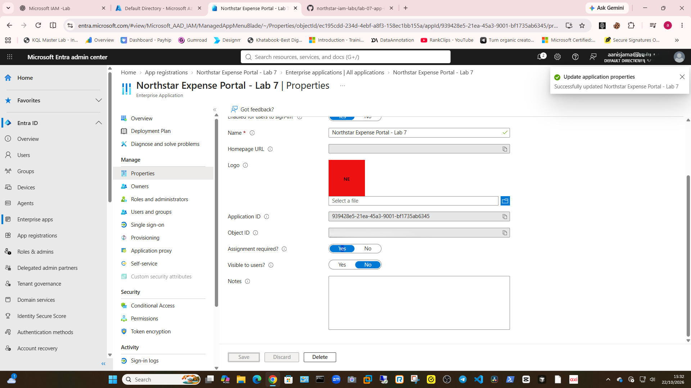
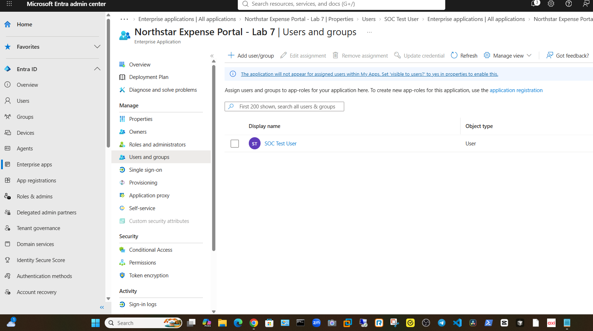
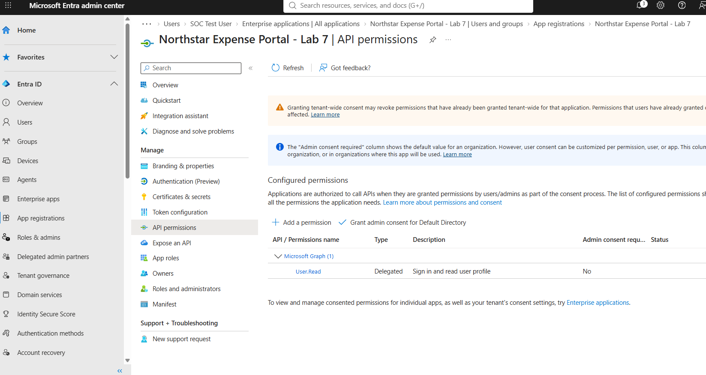

# Lab 7 — App Registrations and Service Principals

## Objective

Understand how Microsoft Entra ID represents an app registration and its tenant-specific service principal. Practise reviewing permissions and controlling application access.

## Scenario

Northstar’s IT team is assessing a test application before allowing it to access company resources. The analyst must identify the application objects, review permissions, and limit access.

## Workflow completed

1. Created a single-tenant app registration named **Northstar Expense Portal – Lab 7**.
2. Located and verified its enterprise application (service principal).
3. Set **Assignment required** to **Yes**.
4. Assigned the **SOC Test User** account to the application.
5. Reviewed the configured API permissions without granting admin consent or adding permissions.

## Evidence

### App registration

### Enterprise application / service principal

### Assignment control

### User assignment

### API permissions

## Results

- App registration created and its enterprise application (service principal) verified.
- **Assignment required** is **Yes**; **SOC Test User** is assigned.
- The only configured permission shown is Microsoft Graph **User.Read (Delegated)**. No additional permissions or admin consent were granted.
- Interactive sign-in was not tested because no redirect URI or sign-in flow was configured.
- The tenant uses Microsoft Entra ID Free. Paid governance features were not tested.

## Security notes

- Kept access limited to the test user.
- Did not create a client secret or grant broad permissions.
- Screenshots were redacted before upload.
