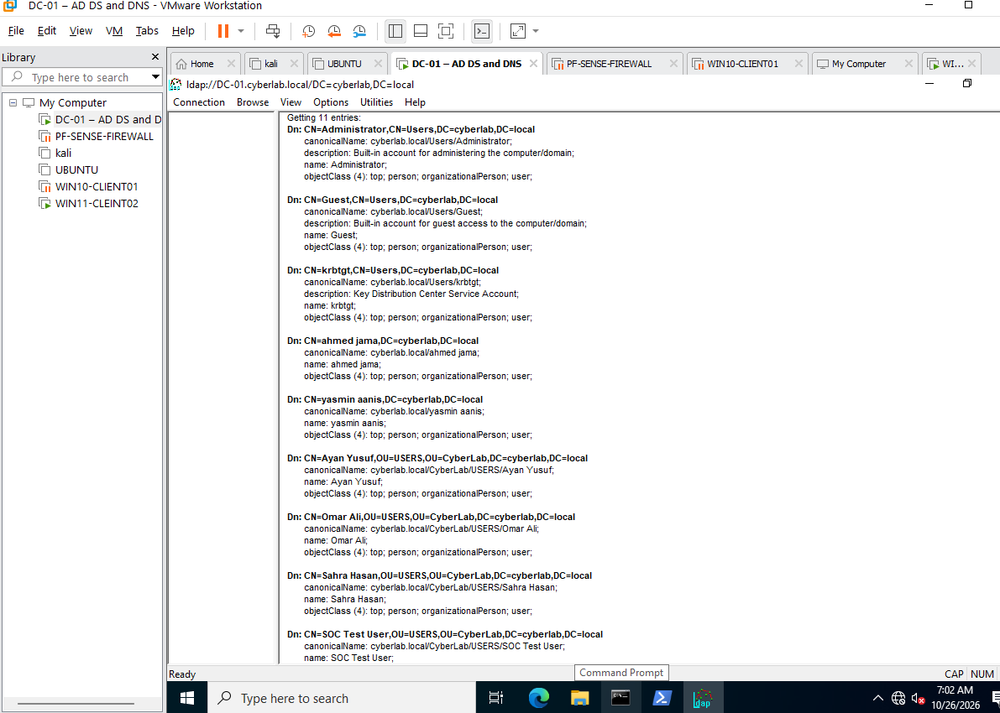

# Lab 11: LDAP Basics

## Goal
Test LDAP connectivity to Active Directory and search the directory for person objects.

## Environment
- Domain: `cyberlab.local`
- Domain controller: `DC-01`
- Client: `WIN11-CLIENT02`

## Checks performed
- From WIN11-CLIENT02, tested TCP port 389 on DC-01. `TcpTestSucceeded` returned `True`.
- In Ldp.exe, connected to `DC-01` on port `389`.
- Checked the RootDSE information. The default naming context was `DC=cyberlab,DC=local`.
- Searched the directory using:
  - **Base DN:** `DC=cyberlab,DC=local`
  - **Filter:** `(objectCategory=person)`
  - **Scope:** Subtree
- Ldp.exe returned 11 directory entries.

## Result
LDAP connectivity and a directory search were successful. No directory objects were changed.

## Evidence

