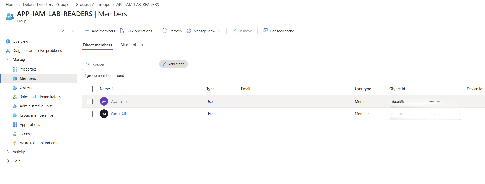
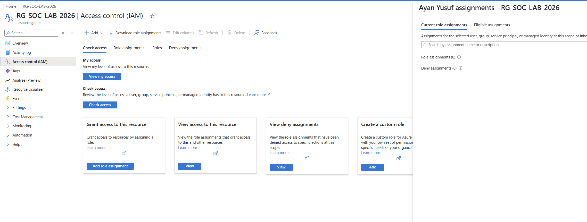
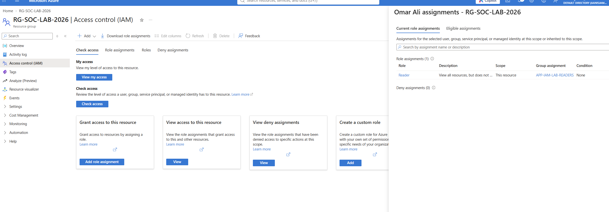

# Lab 12: RBAC and Least Privilege

## Objective
Choose an appropriate role and scope, grant access through a group, verify effective access, and remove access when it is no longer needed.

## Entra directory-role exercise
- Reviewed the Password Administrator role and its permissions.
- Assigned it to the SOC Test User at directory scope, then removed the temporary assignment.
- No password was reset; this demonstrated role assignment and removal.

## Azure resource RBAC exercise

### Configuration
- **Role:** Reader — allows viewing resources but not changing them.
- **Group:** `APP-IAM-LAB-READERS`
- **Scope:** `RG-SOC-LAB-2026` resource group.
- **Reason:** Reader provides the required view access, and the resource-group scope limits the assignment to the lab resources.

### Access verification
- Before removal, Ayan Yusuf and Omar Ali were members of `APP-IAM-LAB-READERS`.
- Ayan Yusuf was removed from the group for this simulated lab exercise.
- After removal, Ayan Yusuf had 0 role assignments at or inherited to the resource group.
- Omar Ali retained Reader access through `APP-IAM-LAB-READERS`.
- The Azure portal also showed my lab account’s separate Owner access inherited from the subscription.

### How to check access
- **Direct:** Look for a role assignment made to the user.
- **Group-based:** Check the user’s group membership and whether that group has a role assignment.
- **Inherited:** Check whether a role assignment comes from a parent scope, such as a subscription.

### Approval and review process
In a workplace, access should be requested with a business reason, role, scope, and duration. An authorized person should approve it before access is granted. Review access periodically, and remove it when the person changes role or leaves. This approval and review process was not configured in this home lab.

### Azure RBAC and application access
Azure resource RBAC controls access to Azure resources. Entra enterprise-application assignments control access to a particular application. One does not automatically grant the other.

## Evidence

**Before removal — group membership:**

**After removal — no assignments at the resource-group scope:**

**Remaining group access — Omar retains Reader through the group:**

## Result
The lab demonstrated least-privilege Reader access at resource-group scope, group-based access verification, and removal of a user’s access by changing group membership. The removal was a simulated lab action.
